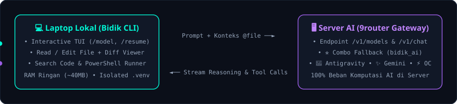

<div align="center">



<br/>

[](https://www.python.org/)
[](#)
[](#)
[](#)

<p align="center">
  <b>Otak AI di Server <code>9router</code> • Tangan Eksekutor Koding Langsung di Terminal Laptop Anda</b><br/>
  <sub>Ringan (~40 MB RAM) • Tanpa <code>npm</code> • Live Model Selector • Smart Session Resume • Unified Diff Preview</sub>
</p>

[✨ Fitur Utama](#-fitur-utama) •
[🎬 Live Demo](#-tampilan-interaktif) •
[🧠 Arsitektur](#-arsitektur-kerja) •
[🚀 Instalasi Cepat](#-cara-instalasi) •
[⌨️ Perintah](#-daftar-slash-commands)

</div>

---

## 🎬 Tampilan Interaktif

<div align="center">
  
</div>

---

## ✨ Fitur Utama

<table>
  <tr>
    <td width="50%">
      <h3>🔀 Live Model Picker (<code>/model</code>)</h3>
      <p>Menarik daftar puluhan model AI secara <i>real-time</i> dari endpoint <code>/v1/models</code> server <b>9router</b> (Combo, Antigravity, Gemini, OpenCode, Ollama) lengkap dengan kotak pencarian instan &amp; navigasi tombol panah.</p>
    </td>
    <td width="50%">
      <h3>⚡ Autocomplete Pintar (<code>/</code> &amp; <code>@file</code>)</h3>
      <p>Ketik <code>/</code> untuk memunculkan menu perintah melayang secara otomatis, atau ketik <code>@</code> (contoh: <code>perbaiki bug di @auth.py</code>) untuk mencari dan melampirkan kode proyek langsung ke konteks AI.</p>
    </td>
  </tr>
  <tr>
    <td width="50%">
      <h3>🛠️ Coding Agent &amp; PC Diagnostics</h3>
      <p>AI dapat menjelajahi folder (<code>list_files</code>), mencari kode (<code>search_code</code>), mengedit file dengan <b>preview diff hijau/merah</b> (<code>edit_file</code>), serta mengecek penyebab <b>PC lemot</b> (CPU, RAM, Disk &amp; aplikasi berat via <code>check_pc_health</code>) dengan izin <b>Yes / No</b> Bahasa Indonesia.</p>
    </td>
    <td width="50%">
      <h3>🕒 Smart Session Cache (<code>/resume</code>)</h3>
      <p>Percakapan tersimpan otomatis sehingga dapat dilanjutkan kapan saja via <code>/resume</code> atau <code>bidik -c</code>. Dilengkapi <b>auto-cleanup</b> (maksimal 20 sesi terakhir) agar penyimpanan tetap bersih &amp; ringan.</p>
    </td>
  </tr>
</table>

---

## 🧠 Arsitektur Kerja

<div align="center">
  
</div>

> [!TIP]
> **Sangat Hemat Memori:** Seluruh komputasi model LLM dijalankan 100% di server `9router`. Saat `bidik` ditutup (`/exit`), pemakaian RAM di laptop kembali **0 MB** tanpa ada *background daemon* yang membebani sistem.

---

## 📋 Prasyarat

* **Windows 10 / 11** *(Jika di laptop belum ada Python, **`install.bat` akan otomatis mengunduh & memasangkan Python 3.12 resmi** untuk Anda — tidak perlu install manual dan tidak memerlukan Node.js / `npm`!).*
* Terhubung ke jaringan LAN kantor atau VPN yang dapat mengakses server **`9router`**.

---

## 🚀 Cara Instalasi

### Metode 1 — *One-Click Installer* Windows (`install.bat`) ⭐ *Paling Mudah*

1. **Clone** repositori ini (atau ekstrak file `bidik-cli-installer.zip`):
   ```powershell
   git clone https://github.com/YeQiu29/bidik-ai-cli.git
   cd bidik-ai-cli
   ```
2. Klik 2x file **`install.bat`** (atau jalankan `.\install.bat` di PowerShell):
   * Otomatis menyalin program ke `~/.bidik-cli` dan membangun *isolated virtual environment* (`.venv`) agar **tidak menyentuh library Python global** laptop Anda.
   * Otomatis mendaftarkan perintah `bidik` ke *User PATH* tanpa memerlukan *Run as Administrator*.
3. Buka jendela terminal **baru**, lalu ketik:
   ```powershell
   bidik
   ```

### Metode 2 — Install Langsung via `pip` dari GitHub (Windows / Linux / macOS)

```bash
pip install git+https://github.com/YeQiu29/bidik-ai-cli.git
```

---

## 💻 Cara Penggunaan Cepat

Buka terminal di folder proyek kodingan mana saja:

```powershell
# Masuk ke mode interaktif penuh (TUI)
bidik

# Langsung melanjutkan sesi percakapan terakhir di proyek ini
bidik -c

# Membuka daftar riwayat sesi sebelumnya saat masuk
bidik -r

# Mode perintah kilat satu baris (one-shot)
bidik "jelaskan alur autentikasi pada folder ini"
```

> [!IMPORTANT]
> **Setup Pertama Kali:** Saat pertama kali membuka `bidik`, Anda cukup memasukkan alamat URL Server `9router` (tekan *Enter* untuk default) dan **API Key (`sk-...`)** satu kali saja. Konfigurasi akan tersimpan aman secara lokal di `~/.bidik/config.json`.

---

## 🎛️ Tiga Mode Eksekusi (`/mode`)

| Mode | Ikon | Karakteristik |
| :--- | :---: | :--- |
| **Agent Mode** *(Default)* | `⚡ AGENT` | Membaca kode secara bebas & meminta izin konfirmasi sebelum menyimpan editan file atau menjalankan perintah PowerShell. |
| **Plan / Diskusi Mode** | `🧭 PLAN` | **100% Read-Only.** Sangat aman untuk diskusi arsitektur, *code review*, dan analisis *bug* tanpa mengubah satu baris file pun. |
| **Auto-Edit Mode** | `🚀 AUTO` | Langsung menerapkan perubahan file kode di dalam proyek kerja secara cepat (tetap meminta izin untuk eksekusi perintah terminal). |

---

## ⌨️ Daftar Slash Commands

| Perintah | Kegunaan |
| :--- | :--- |
| `/model` | Membuka pemilih model AI interaktif (*live* dari server `9router`) dengan fitur pencarian & filter |
| `/resume` | Memilih & melanjutkan sesi obrolan sebelumnya (*Smart Session Cache* maks 20 sesi) |
| `/new` | Memulai sesi percakapan baru tanpa menghapus sesi yang sudah tersimpan |
| `/mode` | Mengganti mode kerja antara `Agent`, `Plan`, atau `Auto` |
| `/cd` | Berpindah ke folder kerja aktif lain tanpa keluar dari CLI (contoh: `/cd C:\Projects\app`) |
| `/security` | Memantau batas akses folder aktif AI & mencabut izin sementara (`/security reset`) |
| `/status` | Mengecek status koneksi & latensi server `9router`, ukuran *cache* sesi, serta total pemakaian token |
| `/diff` | Menampilkan *unified diff* warna hijau/merah atas file yang diubah pada sesi ini atau `git status` |
| `/undo` | Membatalkan perubahan kode oleh AI pada sesi ini & mengembalikan file ke versi asli |
| `/clear` | Membersihkan layar terminal & mereset percakapan aktif |
| `/compact` | Meringkas riwayat percakapan panjang untuk menghemat *context window* |
| `/clean` | Menghapus bersih seluruh file *cache* riwayat sesi di disk (`0 KB`) |
| `/update` | Memeriksa & mengunduh pembaruan terbaru Bidik CLI langsung dari GitHub |
| `/config` | Melihat atau memperbarui URL Server (`/config url ...`), API Key, & GitHub Token |
| `/help` | Menampilkan tabel panduan bantuan di dalam terminal |
| `/exit` | Keluar dari Bidik CLI (atau tekan `Ctrl+D`) |

---

<details>
<summary><b>📂 Lihat Struktur Kode Proyek</b></summary>
<br/>

```text
bidik-ai-cli/
├── assets/
│   ├── hero-banner.svg      # Animasi SVG header utama
│   ├── terminal-demo.svg    # Animasi simulasi sesi terminal TUI
│   └── architecture.svg     # Animasi aliran data Laptop <-> 9router
├── bidik_cli/
│   ├── __init__.py          # Informasi versi paket
│   ├── main.py              # Entry point CLI & router slash command
│   ├── config.py            # Manajemen konfigurasi (~/.bidik/config.json & .env)
│   ├── client.py            # Klien OpenAI streaming, parser <think> & katalog model
│   ├── ui.py                # Desain TUI Rich, diff viewer & interactive pickers
│   ├── completer.py         # Popup autocomplete otomatis untuk '/' dan '@file'
│   ├── sessions.py          # Penyimpanan sesi pintar dengan auto-cleanup
│   ├── agent.py             # Multi-step agentic loop & eksekusi tool berantai
│   └── tools.py             # Local coding tools terproteksi di dalam workspace
├── install.bat              # One-click installer untuk Windows
├── install.ps1              # Script PowerShell otomatis pendamping installer
├── uninstall.bat            # One-click uninstaller bersih
├── .env.example             # Template konfigurasi environment variable
├── .gitignore               # Filter file lokal agar repo tetap bersih
└── pyproject.toml           # Definisi paket Python & registrasi perintah `bidik`
```

</details>

<details>
<summary><b>🗑️ Cara Uninstall Bersih (Windows)</b></summary>
<br/>

Klik 2x file **`uninstall.bat`** (atau jalankan `%USERPROFILE%\.bidik-cli\uninstall.bat`). Script akan menghapus folder `.venv` terisolasi serta membersihkan *entry* `bidik` dari *User PATH* tanpa meninggalkan residu pada sistem Anda.

</details>

---

<div align="center">
  <sub>Powered By <b>Dennis Hilmansyah</b> • Dibangun dengan Python, Rich, Prompt Toolkit &amp; OpenAI SDK</sub>
</div>
